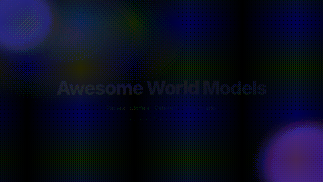

# Awesome World Models    

## Launch video

<video src="https://raw.githubusercontent.com/rajasekharponakala/awesome-world-models/main/brag.mp4" autoplay muted loop playsinline controls width="720" poster="https://raw.githubusercontent.com/rajasekharponakala/awesome-world-models/main/preview.gif"></video>

[Watch full video (brag.mp4)](https://raw.githubusercontent.com/rajasekharponakala/awesome-world-models/main/brag.mp4)

> A curated list of papers, code, datasets, benchmarks, and resources on **world models** — learned simulators of environments that enable prediction, planning, and decision-making in AI.

World models compress experience into a latent representation of how the world evolves, letting agents imagine futures, plan, and learn efficiently. This list covers foundational work through modern video, 3D, driving, and embodied world models.

## Contents

- [Surveys & Overviews](#surveys--overviews)
- [Foundational Papers](#foundational-papers)
- [Video World Models](#video-world-models)
- [3D & Spatial World Models](#3d--spatial-world-models)
- [Driving World Models](#driving-world-models)
- [Robotics & Embodied World Models](#robotics--embodied-world-models)
- [Game & Interactive World Models](#game--interactive-world-models)
- [Benchmarks & Evaluation](#benchmarks--evaluation)
- [Datasets](#datasets)
- [Implementations & Frameworks](#implementations--frameworks)
- [Tools & Libraries](#tools--libraries)
- [Tutorials & Talks](#tutorials--talks)
- [Contributing](#contributing)

## Surveys & Overviews

- [A Survey on World Models (2024)](https://arxiv.org/abs/2411.03559) - Overview of world model architectures, training, and applications.
- [World Models for Autonomous Driving: An Initial Survey](https://arxiv.org/abs/2403.02437) - World models in self-driving.
- [From World Models to World Simulators (2024)](https://arxiv.org/abs/2409.16863) - Generative world simulators and their evaluation.

## Foundational Papers

- [World Models (Ha & Schmidhuber, 2018)](https://arxiv.org/abs/1803.10122) - VAE + RNN learned in latent space; agents trained inside dreams. [code](https://github.com/hardmaru/WorldModels)
- [Learning Latent Dynamics for Planning from Pixels (PlaNet, 2019)](https://arxiv.org/abs/1811.04551) - RSSM latent dynamics for pixel-based planning.
- [Dream to Control (Dreamer, 2020)](https://arxiv.org/abs/1912.01603) - Actor-critic in imagined trajectories.
- [Mastering Atari with Discrete World Models (DreamerV2, 2021)](https://arxiv.org/abs/2010.02193) - Discrete latent dynamics; SOTA Atari.
- [Mastering Diverse Domains through World Models (DreamerV3, 2023)](https://arxiv.org/abs/2301.04104) - Single config across domains. [code](https://github.com/danijar/dreamerv3)
- [MuZero (2020)](https://arxiv.org/abs/1911.08265) - Model-based RL without rules; plans with learned model.
- [A Path Towards Autonomous Machine Intelligence (JEPA, LeCun, 2022)](https://arxiv.org/abs/2301.08243) - Joint-embedding predictive architecture.
- [I-JEPA (2023)](https://arxiv.org/abs/2301.08243) - Image JEPA for self-supervised learning.
- [V-JEPA (2024)](https://arxiv.org/abs/2404.08471) - Video JEPA for understanding. [code](https://github.com/facebookresearch/jepa)
- [V-JEPA 2 (2025)](https://arxiv.org/abs/2506.09985) - Improved video JEPA for prediction and planning.
- [TD-MPC (2022)](https://arxiv.org/abs/2203.04955) - Temporal difference MPC with learned model.
- [TD-MPC2 (2024)](https://arxiv.org/abs/2310.16828) - Scalable model-based RL. [code](https://github.com/nicklashansen/tdmpc2)
- [IRIS (2023)](https://arxiv.org/abs/2209.00588) - Transformer world model with discrete tokens. [code](https://github.com/eloialonso/iris)
- [DIAMOND (2024)](https://arxiv.org/abs/2405.12399) - Diffusion world model. [code](https://github.com/eloialonso/diamond)

## Video World Models

> Featured example: [Sora (OpenAI, 2024)](https://en.wikipedia.org/wiki/Sora_(text-to-video_model)) - Text-to-video world simulator.

- [Sora (OpenAI, 2024)](https://en.wikipedia.org/wiki/Sora_(text-to-video_model)) - Text-to-video world simulator.
- [Genie (DeepMind, 2024)](https://arxiv.org/abs/2402.15391) - Generative interactive environment from video.
- [Genie 2 (DeepMind, 2024)](https://deepmind.google/discover/blog/genie-2-a-large-scale-foundation-world-model/) - Large-scale foundation world model.
- [VideoPoet (Google, 2024)](https://arxiv.org/abs/2312.14125) - LLM for video generation.
- [Phenaki (Google, 2022)](https://arxiv.org/abs/2210.02399) - Variable-length text-to-video.
- [Make-A-Video (Meta, 2022)](https://arxiv.org/abs/2209.14792) - Text-to-video without paired data.
- [Imagen Video (Google, 2022)](https://arxiv.org/abs/2210.02303) - High-fidelity video generation.
- [Stable Video Diffusion (Stability, 2024)](https://arxiv.org/abs/2311.15127) - Open video diffusion model.
- [CogVideo / CogVideoX (THU, 2024)](https://arxiv.org/abs/2408.06072) - Open text-to-video. [code](https://github.com/THUDM/CogVideo)
- [Open-Sora (HPC-AI, 2024)](https://github.com/hpcaitech/Open-Sora) - Open reproduction of Sora.
- [Latte (2024)](https://arxiv.org/abs/2401.03048) - Latent diffusion transformer for video.
- [Pyramid Flow (2024)](https://arxiv.org/abs/2410.05954) - Efficient video generation.
- [HunyuanVideo (Tencent, 2024)](https://arxiv.org/abs/2412.03603) - Open video foundation model.
- [Wan 2.1 (Alibaba, 2025)](https://arxiv.org/abs/2503.20314) - Open video generation.
- [Cosmos (NVIDIA, 2025)](https://arxiv.org/abs/2501.03575) - World foundation model platform. [code](https://github.com/NVIDIA/Cosmos)
- [LTX-Video (Lightricks, 2024)](https://arxiv.org/abs/2501.00103) - Real-time video generation.
- [Mochi (Genmo, 2024)](https://github.com/genmoai/mochi) - Open video model.
- [Step-Video (StepFun, 2025)](https://arxiv.org/abs/2502.10248) - Text-to-video.
- [Navigation World Models (2024)](https://arxiv.org/abs/2412.03572) - Predictive models for navigation.

## 3D & Spatial World Models

> Featured example: [GAIA-1 (Wayve, 2023)](https://arxiv.org/abs/2309.17080) - Generative world model for autonomous driving (video + 3D).

- [GAIA-1 (Wayve, 2023)](https://arxiv.org/abs/2309.17080) - Generative world model for autonomous driving (video + 3D).
- [GAIA-2 (Wayve, 2025)](https://wayve.ai/thinking/gaia-2/) - Scaling generative world models.
- [WonderJourney (2024)](https://arxiv.org/abs/2310.03974) - 3D scene generation from a single image.
- [LucidDreamer (2024)](https://arxiv.org/abs/2311.13384) - Domain-free 3D scene generation.
- [SceneDreamer (2023)](https://arxiv.org/abs/2302.01330) - Unbounded 3D scene generation.
- [WonderWorld (2024)](https://arxiv.org/abs/2406.09394) - Interactive 3D world generation.
- [Persistent Nature (2024)](https://arxiv.org/abs/2407.18896) - Scalable 3D world models.

## Driving World Models

> Featured example: [DriveDreamer (2023)](https://arxiv.org/abs/2309.09777) - Driving world model for simulation.

- [DriveDreamer (2023)](https://arxiv.org/abs/2309.09777) - Driving world model for simulation.
- [DriveDreamer2 (2024)](https://arxiv.org/abs/2403.01415) - World model for driving video generation.
- [Drive-WM (2024)](https://arxiv.org/abs/2311.17914) - Multi-view driving world model.
- [MagicDrive (2024)](https://arxiv.org/abs/2310.02600) - Street view generation with 3D control.
- [WoVoGen (2024)](https://arxiv.org/abs/2311.17943) - World volume-aware diffusion.
- [Vista (2024)](https://arxiv.org/abs/2405.12473) - Versatile driving world model.
- [OccWorld (2024)](https://arxiv.org/abs/2403.09655) - 3D occupancy world model.
- [Think2Drive (2024)](https://arxiv.org/abs/2405.03689) - Reinforcement learning with world model for driving.
- [UniAD (2023)](https://arxiv.org/abs/2212.10156) - Unified autonomous driving with task queries.

## Robotics & Embodied World Models

> Featured example: [DayDreamer (2022)](https://arxiv.org/abs/2206.14176) - World models for real-world robot learning.

- [DayDreamer (2022)](https://arxiv.org/abs/2206.14176) - World models for real-world robot learning.
- [UniPi (2023)](https://arxiv.org/abs/2302.02153) - Universal policy via video prediction.
- [SuSIE (2024)](https://arxiv.org/abs/2310.12813) - Subgoal synthesis via image editing.
- [RoboDreamer (2024)](https://arxiv.org/abs/2405.04259) - Compositional world models for robots.
- [GR-1 (2023)](https://arxiv.org/abs/2312.13139) - Generalist robot transformer.
- [GR-2 (2024)](https://arxiv.org/abs/2410.06158) - Scaling up robot learning.
- [RT-2 (2023)](https://arxiv.org/abs/2307.15818) - Vision-language-action models.
- [π0 (Physical Intelligence, 2024)](https://arxiv.org/abs/2410.24164) - Generalist robot policy.
- [Cosmos (NVIDIA)](https://arxiv.org/abs/2501.03575) - World foundation models for robotics.

## Game & Interactive World Models

- [GameNGen (Google, 2024)](https://arxiv.org/abs/2408.14837) - Neural game engine via diffusion.
- [Oasis (Etched, 2024)](https://oasis-model.github.io/) - Real-time playable world model.
- [MineDojo (2022)](https://arxiv.org/abs/2206.08853) - Open-ended embodied agent in Minecraft.
- [Voyager (2023)](https://arxiv.org/abs/2305.16291) - LLM-powered lifelong learning agent.
- [SIMA (DeepMind, 2024)](https://arxiv.org/abs/2404.10179) - Scalable instructable multiworld agent.

## Benchmarks & Evaluation

- [VBench (2023)](https://arxiv.org/abs/2311.17982) - Video generation benchmark.
- [VBench 2.0 (2024)](https://arxiv.org/abs/2408.05801) - Advanced video eval.
- [EvalCrafter (2024)](https://arxiv.org/abs/2310.11440) - Comprehensive T2V evaluation.
- [WorldSimBench (2024)](https://arxiv.org/abs/2406.18009) - World simulation evaluation.
- [T2V-CompBench (2024)](https://arxiv.org/abs/2407.14505) - Compositional T2V benchmark.
- [FVD](https://arxiv.org/abs/1812.01717) - Fréchet Video Distance.
- [Meta-World](https://meta-world.github.io/) - Multi-task RL benchmark.
- [DMControl Suite](https://github.com/deepmind/dm_control) - Continuous control benchmark.
- [ManiSkill](https://maniskill.readthedocs.io/) - Manipulation benchmark.
- [LIBERO](https://libero-project.github.io/) - Lifelong robot learning benchmark.
- [CALVIN](https://github.com/mees/calvin) - Language-conditioned manipulation.

## Datasets

- [Kinetics-400/600/700](https://deepmind.com/research/open-source/kinetics) - Large-scale video.
- [Something-Something v2](https://www.qualcomm.com/developer/software/something-something-v-2-dataset) - Fine-grained video.
- [UCF-101](https://www.crcv.ucf.edu/data/UCF101.php) - Action recognition.
- [BAIR Robot Pushing](https://sites.google.com/view/sna-visual-prediction) - Robot video prediction.
- [RoboNet](https://www.robonet.wiki/) - Multi-robot video.
- [nuScenes](https://www.nuscenes.org/) - Autonomous driving.
- [Waymo Open Dataset](https://waymo.com/open/) - Driving data.
- [KITTI](https://www.cvlibs.net/datasets/kitti/) - Driving.
- [Cityscapes](https://www.cityscapes-dataset.com/) - Urban scenes.
- [Objaverse](https://objaverse.allenai.org/) - 3D objects.
- [ScanNet](http://www.scan-net.org/) - Indoor 3D.
- [Open X-Embodiment](https://robotics-transformer-x.github.io/) - Cross-robot data.
- [D4RL](https://github.com/Farama-Foundation/D4RL) - Offline RL datasets.
- [RL Unplugged](https://github.com/deepmind/deepmind-research/tree/master/rl_unplugged) - Offline RL.

## Implementations & Frameworks

- [WorldModels (hardmaru)](https://github.com/hardmaru/WorldModels) - Original world models code.
- [DreamerV3 (danijar)](https://github.com/danijar/dreamerv3) - Dreamer implementation.
- [TD-MPC2](https://github.com/nicklashansen/tdmpc2) - TD-MPC implementation.
- [IRIS](https://github.com/eloialonso/iris) - Transformer world model.
- [DIAMOND](https://github.com/eloialonso/diamond) - Diffusion world model.
- [Open-Sora](https://github.com/hpcaitech/Open-Sora) - Open Sora reproduction.
- [CogVideo](https://github.com/THUDM/CogVideo) - CogVideo code.
- [V-JEPA](https://github.com/facebookresearch/jepa) - Meta's JEPA code.
- [Cosmos](https://github.com/NVIDIA/Cosmos) - NVIDIA world foundation models.
- [diffusers (Hugging Face)](https://github.com/huggingface/diffusers) - Diffusion pipelines.

## Tools & Libraries

- [Gymnasium](https://gymnasium.farama.org/) - RL environments.
- [MuJoCo](https://mujoco.org/) - Physics simulation.
- [CARLA](https://carla.org/) - Driving simulator.
- [Habitat](https://aihabitat.org/) - Embodied AI simulator.
- [Isaac Sim / Isaac Lab](https://developer.nvidia.com/isaac-sim) - Robotics simulation.
- [PyTorch](https://pytorch.org/) / [JAX](https://jax.readthedocs.io/) - ML frameworks.

## Tutorials & Talks

- [World Models (Ha & Schmidhuber blog)](https://worldmodels.github.io/) - Interactive article.
- [Yann LeCun: A Path Towards Autonomous Machine Intelligence](https://openreview.net/forum?id=BZ5a1r-kVsf) - JEPA vision.
- [Danijar Hafner: Dreamer talks](https://danijar.com/) - Dreamer series.

## Contributing

Contributions welcome! Please read [CONTRIBUTING.md](CONTRIBUTING.md). Add entries via PR with a one-line description and link.

## License

[MIT](LICENSE)
